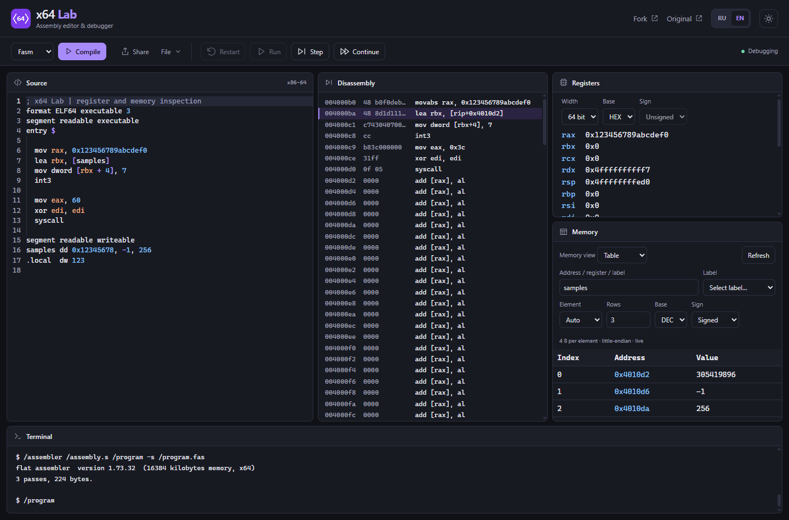

<p></p>

# x64 Lab

A bilingual x86-64 assembly playground with step-by-step debugging, x87 stack inspection, and live memory views. Runs entirely in your browser.

[Open x64 Lab](https://kglebb.github.io/x86-64-playground/) · [Design system](https://kglebb.github.io/x86-64-playground/docs.html) · [Русский](README.ru.md) · [Original project](https://github.com/robalb/x86-64-playground)

[](https://github.com/KGlebB/x86-64-playground/actions/workflows/deploy_github_pages.yml) [](LICENSE.txt)



## Features

- Assemble with FASM, NASM, or GNU as, step through instructions, and inspect disassembly, flags, and terminal output.
- Syntax highlighting follows the selected assembler and supports Intel syntax in GNU as.
- Hover over a supported instruction mnemonic to see a short description and a link to the instruction reference. With the caret on the mnemonic, press **Ctrl+K**, then **Ctrl+I** (**Cmd+K**, then **Cmd+I** on macOS).
- View the low 64, 32, or 16 bits of general-purpose registers in hexadecimal, decimal, octal, or binary. Decimal values support signed and unsigned interpretation.
- Step through x87 instructions and inspect the logical stack `ST(0)`–`ST(7)`, empty slots, the stack pointer `TOP`, and the control, status, and tag words `FCW`, `FSW`, and `FTW`. Blink represents x87 stack values as 64-bit floating-point numbers.
- Inspect memory as a stack byte dump or a live table. **By address** reads 1-, 2-, 4-, or 8-byte little-endian elements from an expression such as `rsp+16` or `array+4`. FASM and NASM labels resolve the element size for unambiguous declarations.
- Use **Read/write segments** to view all `segment readable writeable` segments of a compiled FASM ELF64 program. The table shows addresses, values, labels and declaration types where available, and a row for each array element. Large ranges use pages of 128 rows.
- Select **Float64** to interpret an 8-byte value as a double and see its exact bits in hexadecimal. With **HEX** selected in the segment overview, `dq` declarations initialized with simple floating-point literals also show their Float64 values automatically.
- Switch between English and Russian, and between light and dark themes. Preferences are saved locally. Russian is the initial interface language.
- Use a resizable desktop workspace or keyboard-accessible tabs on smaller screens. Load statically linked x86-64 ELF files or share source snippets through a URL.

Assembly and execution use the bundled Blink WebAssembly emulator locally in the browser. This fork does not include the upstream analytics counter. No server-side execution service is required. Offline reloads are not guaranteed.

## Try the x87 example

1. Open **File → Load example → x87 stack (FASM)**, then select **Compile**.
2. Open **Memory → Table → Scope → Read/write segments**. The segment contains `two dq 2.0` and `result dq 0.0`.
3. Step through the first five instructions. Watch the stack in **Registers → x87**. After `fstp qword [result]`, `result` shows `3.0` with the bits `0x4008000000000000`.

## Run locally

Use **Node.js 20** (20.11.1 or newer within the 20.x series) and **npm 10**.

```sh
git clone --recurse-submodules https://github.com/KGlebB/x86-64-playground.git
cd x86-64-playground/webapp
npm ci
npm run dev
```

The development URL includes `/x86-64-playground/`. Precompiled emulator and assembler binaries are committed, so web interface changes do not require rebuilding Blink.

## Check and build

From `webapp`:

```sh
npm test
npm run build
npm run preview
```

Tests cover precise integer formatting, guest memory page boundaries, FASM/NASM assembly and execution, x87 writes to FASM data segments, Float64 display, translations, UI preferences, and application metadata. GitHub Actions runs the tests before deploying `webapp/dist` to GitHub Pages.

## Project and attribution

This repository is [KGlebB's fork](https://github.com/KGlebB/x86-64-playground) of [x86-64 playground by Alberto Ventafridda](https://github.com/robalb/x86-64-playground). x64 Lab adds register and memory inspection controls, localization, themes, and a redesigned workspace.

The emulator uses [robalb's Blink library fork](https://github.com/robalb/blink), based on [jart/blink](https://github.com/jart/blink). See [the design notes](docs/design.md), [emulator build instructions](docs/setup.md), and [web development notes](webapp/README.md).

The original ISC license and copyright notice are preserved in [LICENSE.txt](LICENSE.txt). The new x64 Lab SVG identity replaces the original wizard artwork in the application; historical documentation assets retain their original attribution to [Nur Achmadi Yusuf](https://thenounproject.com/icon/wizard-hat-6586306/).
