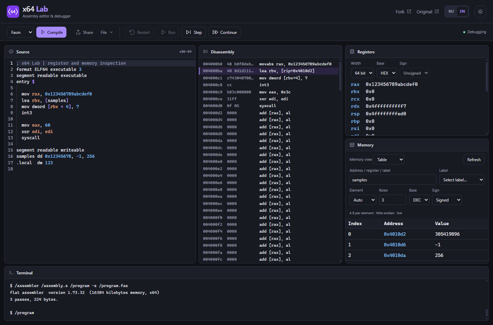

<p></p>

# x64 Lab

Среда для работы с ассемблером x86-64 в браузере с пошаговой отладкой, просмотром стека x87 и обновляемой таблицей памяти. Русский и английский интерфейсы, светлая и тёмная темы.

[Открыть x64 Lab](https://kglebb.github.io/x86-64-playground/) · [Дизайн-система](https://kglebb.github.io/x86-64-playground/docs.html) · [English](README.md) · [Оригинальный проект](https://github.com/robalb/x86-64-playground)



## Возможности

- Сборка через FASM, NASM и GNU as, пошаговое выполнение, дизассемблер, флаги и терминал.
- Подсветка учитывает синтаксис выбранного ассемблера и поддерживает синтаксис Intel в GNU as.
- Наведите указатель на поддерживаемую мнемонику инструкции, чтобы увидеть краткое описание на английском и ссылку на справочник. С клавиатуры поставьте курсор на мнемонику и нажмите **Ctrl+K**, затем **Ctrl+I** (на macOS — **Cmd+K**, затем **Cmd+I**).
- Регистры общего назначения отображаются в разрядности 64, 32 или 16 бит в HEX, DEC, OCT и BIN. В DEC можно выбирать представление со знаком и без знака.
- При пошаговом выполнении инструкций x87 видны логический стек `ST(0)`–`ST(7)`, пустые ячейки, указатель вершины `TOP` и слова управления, состояния и тегов `FCW`, `FSW`, `FTW`. Blink хранит значения стека x87 как 64-битные числа с плавающей точкой.
- Память доступна как дамп стека и обновляемая таблица. Режим **По адресу** читает элементы по 1, 2, 4 или 8 байт в порядке little-endian. Можно указать числовой адрес или выражение `rsp+16` или `array+4`. Для однозначных объявлений FASM и NASM размер определяется по метке.
- Режим **Сегменты чтения и записи** показывает все `segment readable writeable` собранной программы FASM ELF64. В таблице видны адреса, значения, распознанные метки и типы объявлений. Элементы массивов идут отдельными строками, по 128 строк на страницу.
- Формат **Float64** интерпретирует 8-байтовое значение как вещественное число и показывает исходные биты в HEX. В обзоре сегментов при выбранном **HEX** объявления `dq` с простыми вещественными литералами автоматически отображаются и как Float64.
- Переключение RU/EN и светлой/тёмной темы с сохранением предпочтений в браузере. При первом запуске язык русский, тема определяется системой.
- Изменяемые панели на широком экране и вкладки с клавиатурным управлением на узком. Загрузка статически скомпонованных ELF-файлов x86-64 и обмен исходниками через ссылку.

Сборка и выполнение происходят локально в браузере через WebAssembly-эмулятор Blink. Внешний счётчик аналитики оригинального проекта удалён. Сервер для выполнения программ не требуется. Повторная загрузка страницы без интернета не гарантируется.

## Пример со стеком x87

1. Откройте **Файл → Загрузить пример → Стек x87 (FASM)** и нажмите **Собрать**.
2. Откройте **Память → Таблица → Область → Сегменты чтения и записи**. В сегменте появятся `two dq 2.0` и `result dq 0.0`.
3. Выполните первые пять инструкций кнопкой **Шаг**. Наблюдайте за стеком в разделе **Регистры → x87**. После `fstp qword [result]` в строке `result` появятся `3.0` и биты `0x4008000000000000`.

## Локальный запуск

Требуются **Node.js 20** (от 20.11.1 в пределах ветки 20.x) и **npm 10**.

```sh
git clone --recurse-submodules https://github.com/KGlebB/x86-64-playground.git
cd x86-64-playground/webapp
npm ci
npm run dev
```

Адрес включает `/x86-64-playground/`. Готовые бинарные файлы эмулятора и ассемблеров включены в репозиторий: изменения веб-интерфейса не требуют пересборки Blink.

## Проверка и сборка

В каталоге `webapp`:

```sh
npm test
npm run build
npm run preview
```

Тесты проверяют точность целых чисел, чтение на границах страниц памяти, сборку и выполнение FASM/NASM, запись из стека x87 в сегмент данных FASM, отображение Float64, переводы, настройки и метаданные. GitHub Actions запускает тесты перед публикацией `webapp/dist` на GitHub Pages.

## Происхождение и лицензия

Проект — [форк KGlebB](https://github.com/KGlebB/x86-64-playground) на основе [x86-64 playground Альберто Вентафридды](https://github.com/robalb/x86-64-playground). В x64 Lab добавлены расширенный просмотр регистров и памяти, локализация, темы и новая компоновка интерфейса.

Эмулятор использует [библиотечный форк Blink](https://github.com/robalb/blink) на основе [jart/blink](https://github.com/jart/blink). Дополнительные сведения: [архитектура](docs/design.md), [сборка эмулятора](docs/setup.md), [разработка веб-приложения](webapp/README.md).

Исходная лицензия ISC и уведомление об авторских правах сохранены в [LICENSE.txt](LICENSE.txt). Новая SVG-эмблема x64 Lab используется в приложении; исторические изображения документации сохраняют атрибуцию [Nur Achmadi Yusuf](https://thenounproject.com/icon/wizard-hat-6586306/).
